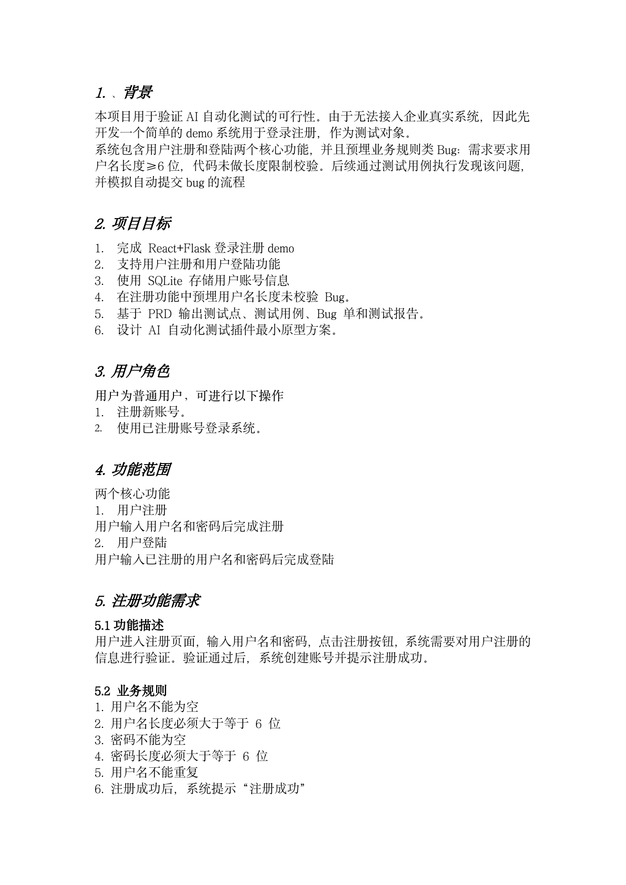
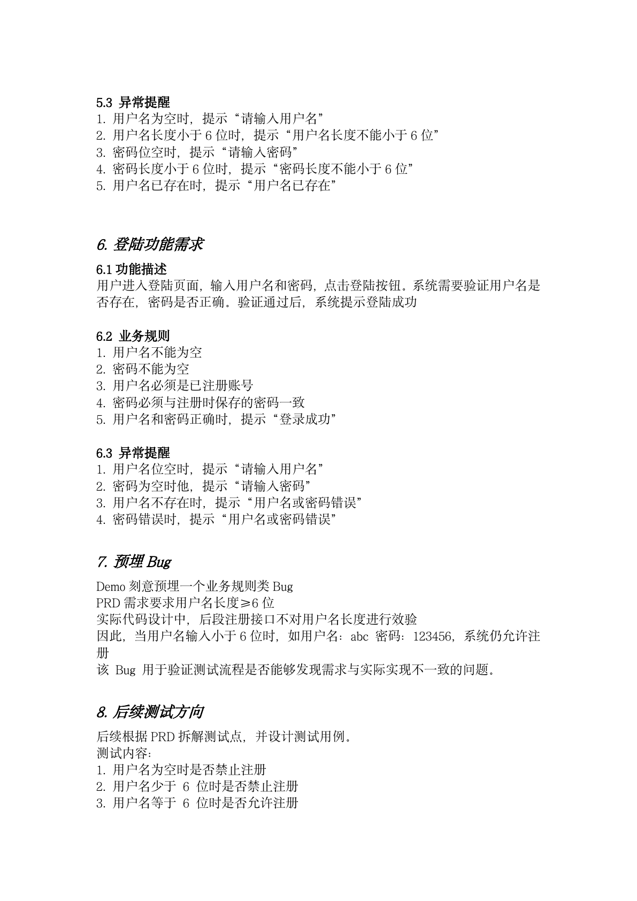

# 自动化测试全流程插件原型 + React Flask 登录注册 Demo

## 项目简介

本项目用于验证 AI 驱动的一站式自动化测试插件最小闭环，覆盖从 PRD 分析、需求拆解、测试用例设计、用例执行、测试报告生成到 Bug 单提交的完整流程。

由于当前没有公司内部系统权限，项目先以一个简易的 React + Flask 登录注册 Demo 作为最小可验证对象，用于沉淀自动化测试插件的原型方案和测试流程材料。

## 项目目标

- 设计并开发前后端分离的登录注册 Demo 系统
- 通过人工预埋业务规则类 Bug，模拟真实测试发现问题的过程
- 输出 PRD、需求分析、测试用例、测试报告、Bug 单等完整交付物
- 梳理 AI 自动化测试插件从 PRD 到 Bug 提交的执行链路
- 为后续开发正式插件提供可复用的原型基础

## 技术栈

- 前端：React、Axios、React Router、Ant Design
- 后端：Flask、Python、SQLite
- 测试：手工测试、接口测试、测试报告、Bug 管理规范
- 插件方向：大模型 PRD 解析、Prompt 工程、测试用例自动生成

## 核心功能规划

- 用户注册
- 用户登录
- 表单校验
- 登录状态跳转
- 基础异常提示

## 预埋 Bug 说明

需求要求用户名长度不少于 6 位，但注册接口计划故意不做用户名长度校验。

该问题用于模拟自动化测试插件发现 Bug 的流程：

1. 从 PRD 中解析出用户名长度规则
2. 自动生成边界值测试用例
3. 执行用户名少于 6 位的注册场景
4. 识别实际结果与需求不一致
5. 自动生成测试报告和 Bug 单

## 当前仓库内容

```text
.
├── README.md
└── docs
    ├── PRD.pdf
    ├── PRD.wps
    └── preview
        ├── prd-page-1.png
        ├── prd-page-2.png
        └── prd-page-3.png
```

## 文档入口

- [PRD 文档 PDF 版](docs/PRD.pdf)
- [PRD 文档 PDF 原始文件](https://raw.githubusercontent.com/rsm-pez018/ai-test-plugin-login-demo/main/docs/PRD.pdf)
- [PRD 文档 WPS 原文件](docs/PRD.wps)

说明：GitHub 对 `.wps` 文件通常不能直接在线预览，建议优先查看 PDF 版；WPS 原文件可下载后用 WPS Office 打开。

## PRD 页面预览






## 后续交付物

- React 前端工程
- Flask 后端工程
- SQLite 数据库初始化脚本
- 需求规格说明书
- 测试用例设计文档
- 手工测试执行记录
- 接口测试执行记录
- 测试报告
- 标准化 Bug 单
- AI 自动化测试插件原型设计方案
